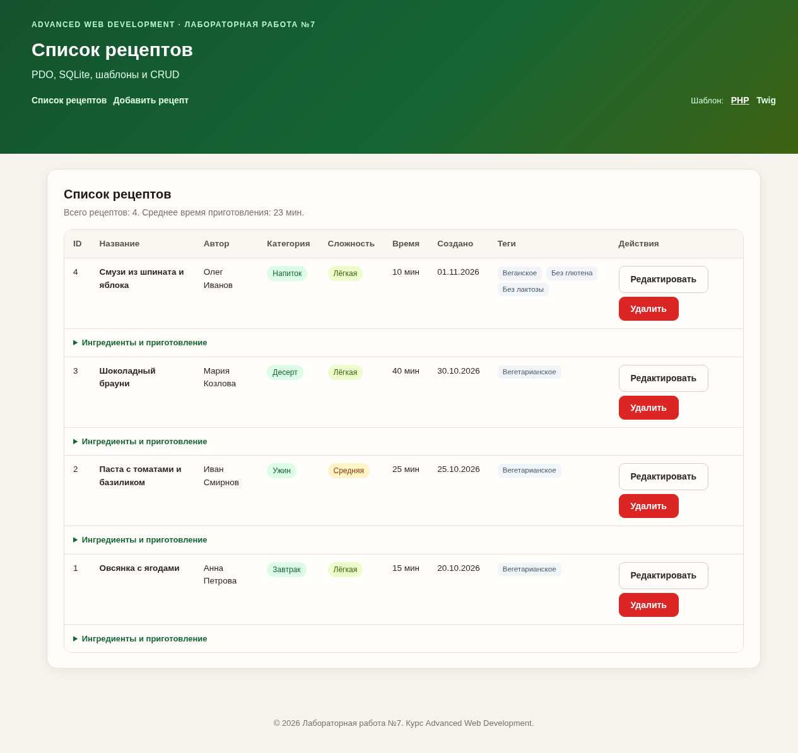
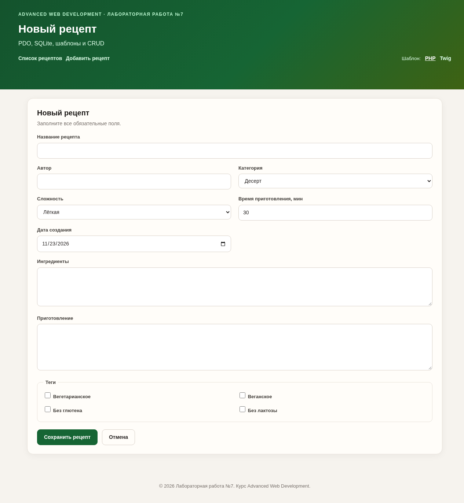

# Лабораторная работа №7. Шаблонизация и работа с базой данных

## Цель работы

Освоить принципы шаблонизации в PHP с использованием нативных PHP-шаблонов и готового шаблонизатора Twig, а также работу с реляционной базой данных через PDO. Разделить проект на слои логики и представления, перенести хранение данных из файла в базу данных и реализовать полный цикл CRUD: создание, чтение, обновление и удаление записей.

---

## Структура проекта

```text
lab7/
├── index.php              # Точка входа: список, создание, удаление
├── edit.php               # Страница редактирования записи
├── config.php             # Параметры подключения к БД
├── schema.sql             # SQL-схема таблиц
├── database.sqlite        # База данных SQLite
├── composer.json
├── vendor/                # Зависимости Composer (Twig)
├── main.md
├── image.png
├── image-1.png
├── image-2.png
├── image-3.png
├── src/
│   ├── bootstrap.php      # Инициализация БД, сервисов и шаблонизатора
│   ├── Database.php
│   ├── Recipe.php
│   ├── RecipeRepository.php
│   ├── RecipeService.php
│   ├── RecipeValidator.php
│   ├── RecipeOptions.php
│   ├── View.php
│   ├── helpers.php
│   ├── ValidatorInterface.php
│   └── Validators/
└── templates/
    ├── style.css
    ├── native/
    │   ├── header.php
    │   ├── footer.php
    │   ├── layout.php
    │   ├── list.php
    │   └── form.php
    └── twig/
        ├── layout.twig
        ├── list.twig
        └── form.twig
```

---

## Шаг 1. Разделение на слои

Логика и представление разделены:

- `src/` содержит подключение к БД, модель `Recipe`, репозиторий, сервис, валидацию и класс `View`;
- `templates/native/` и `templates/twig/` содержат только HTML-разметку и вывод переменных;
- в шаблонах нет SQL-запросов, обработки `$_POST`/`$_GET` и других операций с данными;
- все пользовательские строки выводятся через `htmlspecialchars()` (в нативных шаблонах) или через автоэкранирование Twig.

Точка входа `index.php` обрабатывает запросы, подготавливает переменные и вызывает `View::render()`. Шаблоны получают уже готовые данные.

---

## Шаг 2. База данных

Использована реляционная база данных SQLite. В проекте минимум две таблицы и связь «один ко многим»: одна категория может иметь много рецептов.

`schema.sql`:

```sql
PRAGMA foreign_keys = ON;

CREATE TABLE IF NOT EXISTS categories (
    id INTEGER PRIMARY KEY AUTOINCREMENT,
    slug TEXT NOT NULL UNIQUE,
    name TEXT NOT NULL,
    created_at TEXT NOT NULL DEFAULT (datetime('now'))
);

CREATE TABLE IF NOT EXISTS recipes (
    id INTEGER PRIMARY KEY AUTOINCREMENT,
    title TEXT NOT NULL,
    author TEXT NOT NULL,
    category_id INTEGER NOT NULL,
    difficulty TEXT NOT NULL CHECK (difficulty IN ('easy', 'medium', 'hard')),
    prep_time INTEGER NOT NULL CHECK (prep_time > 0),
    ingredients TEXT NOT NULL,
    instructions TEXT NOT NULL,
    tags TEXT NOT NULL DEFAULT '',
    created_at TEXT NOT NULL,
    updated_at TEXT NOT NULL,
    FOREIGN KEY (category_id) REFERENCES categories(id)
        ON UPDATE CASCADE
        ON DELETE RESTRICT
);
```

При первом запуске `bootstrap.php` выполняет `schema.sql` и заполняет таблицы начальными данными: 4 категории и 4 рецепта. Теги хранятся в поле `tags` как строка с разделителем `,`.

---

## Шаг 3. Подключение к базе данных

Подключение инкапсулировано в классе `Database`:

```php
final class Database
{
    public function __construct(private array $config)
    {
    }

    public function getConnection(): PDO
    {
        $pdo = new PDO('sqlite:' . $this->config['path']);
        $pdo->setAttribute(PDO::ATTR_ERRMODE, PDO::ERRMODE_EXCEPTION);
        $pdo->setAttribute(PDO::ATTR_DEFAULT_FETCH_MODE, PDO::FETCH_ASSOC);
        $pdo->exec('PRAGMA foreign_keys = ON');

        return $pdo;
    }
}
```

Параметры подключения вынесены в `config.php`:

```php
return [
    'db' => [
        'driver' => 'sqlite',
        'path' => __DIR__ . '/database.sqlite',
    ],
    'template_engine' => $_GET['engine'] ?? 'native',
];
```

---

## Шаг 4. Реализация CRUD-операций

CRUD реализован в `RecipeRepository` через подготовленные выражения PDO:

- `allCategories(): array` — получить категории;
- `all(): Recipe[]` — получить все рецепты (с JOIN к категориям);
- `findById(int $id): ?Recipe` — получить один рецепт;
- `create(Recipe $recipe): Recipe` — добавить запись;
- `update(int $id, Recipe $recipe): void` — обновить запись;
- `delete(int $id): void` — удалить запись.

Пример создания записи:

```php
$statement = $this->pdo->prepare(
    'INSERT INTO recipes
        (title, author, category_id, difficulty, prep_time, ingredients, instructions, tags, created_at, updated_at)
     VALUES
        (:title, :author, :category_id, :difficulty, :prep_time, :ingredients, :instructions, :tags, :created_at, :updated_at)'
);

$statement->execute([
    ':title' => $recipe->getTitle(),
    ':author' => $recipe->getAuthor(),
    ':category_id' => $recipe->getCategoryId(),
    // ...
]);
```

Обновление и удаление используют `UPDATE ... WHERE id = :id` и `DELETE FROM recipes WHERE id = :id`. Все запросы выполняются через `prepare()` и именованные параметры.

`RecipeService` объединяет валидацию и репозиторий: методы `create()`, `update()` и `delete()` возвращают результат с ошибками или сохраняют запись в БД.

---

## Шаг 5. Нативные PHP-шаблоны

Представление вынесено в папку `templates/native/`:

- `header.php` — общий заголовок, CSS и навигация;
- `footer.php` — подвал страницы;
- `layout.php` — общий макет: подключает header, выбранный шаблон и footer;
- `list.php` — таблица со списком рецептов;
- `form.php` — форма создания и редактирования.

`View` рендерит нативный шаблон так:

```php
public function render(string $template, array $data): string
{
    if ($this->engine === 'twig') {
        return $this->twig->render($template . '.twig', $data);
    }

    $data['template'] = $template;
    extract($data, EXTR_SKIP);

    ob_start();
    require $this->templateDir . '/native/layout.php';

    return (string) ob_get_clean();
}
```

В шаблонах только вывод данных и простые конструкции `foreach`/`if`. Все пользовательские строки экранируются через `htmlspecialchars()` (функция `e()`). Обращений к БД и обработки `$_POST`/`$_GET` в шаблонах нет.

Страница списка содержит кнопку «Редактировать» рядом с каждой записью (ссылка на `edit.php?id=X`) и кнопку «Удалить» в форме с методом `POST`. Страница редактирования загружает запись из БД, показывает её в форме и при отправке обновляет запись, после чего перенаправляет на `index.php`.

---

## Шаг 6. Шаблонизатор Twig

Установлен Twig 3.30 через Composer. Шаблоны находятся в `templates/twig/`:

- `layout.twig` — базовый макет с ``;
- `list.twig` — список рецептов;
- `form.twig` — форма создания и редактирования.

Переключение между нативным PHP и Twig выполняется параметром `engine`:

```text
index.php?engine=native
index.php?engine=twig
```

Пример шаблона `list.twig`:

```twig



    
        <tr>
            <td>{{ recipe.id }}</td>
            <td><strong>{{ recipe.title }}</strong></td>
            <td>{{ recipe.prepTime|format_duration }}</td>
        </tr>
    

```

Использовано наследование шаблонов: `list.twig` и `form.twig` расширяют `layout.twig` и переопределяют блок `content`.

---

## Дополнительные задания (на 10 баллов)

### Задание 1. Собственный фильтр Twig

Зарегистрирован фильтр `format_duration`, который переводит минуты в удобный формат:

```php
$twig->addFilter(new \Twig\TwigFilter('format_duration', function (int $minutes): string {
    $hours = intdiv($minutes, 60);
    $mins = $minutes % 60;

    if ($hours === 0) {
        return $mins . ' мин';
    }

    if ($mins === 0) {
        return $hours . ' ч';
    }

    return $hours . ' ч ' . $mins . ' мин';
}));
```

Использование в шаблоне:

```twig
{{ recipe.prepTime|format_duration }}
```

Пример результата: `90` → «1 ч 30 мин».

### Задание 2. ООП-реализация

Проект использует объектно-ориентированный подход:

- `Database` — подключение к БД через PDO;
- `Recipe` — модель записи;
- `RecipeRepository` — CRUD-операции с БД;
- `RecipeService` — бизнес-логика создания/обновления;
- `RecipeValidator` — валидация формы;
- `View` — рендеринг нативных и Twig-шаблонов.

Зависимости передаются через конструкторы, а валидаторы реализуют общий интерфейс `ValidatorInterface`. Это разделяет ответственность и упрощает тестирование.

---

## Безопасность

- Все SQL-запросы выполняются через подготовленные выражения PDO.
- Пользовательские данные экранируются через `htmlspecialchars()` или автоэкранирование Twig.
- Формы создания, редактирования и удаления защищены CSRF-токеном из сессии.
- После успешного POST выполняется редирект (PRG), чтобы форма не отправлялась повторно.
- Внешние ключи и ограничения `CHECK` защищают целостность данных в БД.

---

## Результат работы

Нативные PHP-шаблоны:



Шаблоны Twig:


Форма создания (нативные шаблоны):



Форма создания (Twig):


---

## Запуск проекта

Если расширение `pdo_sqlite` включено:

```bash
php -S localhost:8000 -t lab7
```

На данной машине расширение отключено в `php.ini`, поэтому запуск выполнялся так:

```bash
php -c /home/kozak/.local/php/php.ini -S localhost:8000 -t lab7
```

Затем открыть `http://localhost:8000`. Для переключения шаблонизатора использовать параметр `engine`:

```text
http://localhost:8000/index.php?engine=native
http://localhost:8000/index.php?engine=twig
```

Перед первым запуском зависимости устанавливаются командой:

```bash
composer install
```

---

## Контрольные вопросы

### 1. Зачем разделять логику и представление в проекте? Какие проблемы могут возникнуть, если смешивать их в одном файле?

Разделение позволяет независимо менять внешний вид и бизнес-логику, повторно использовать шаблоны, тестировать логику без HTML и упрощает поддержку. Если смешивать PHP-логику и HTML в одном файле, код становится трудночитаемым, увеличивается риск ошибок, сложнее менять дизайн и тестировать, а SQL-запросы могут оказаться прямо в шаблоне.

### 2. В чём отличие нативных PHP-шаблонов от шаблонизатора Twig? Какие преимущества и недостатки у каждого подхода?

Нативные шаблоны используют обычный PHP (`<?php echo ... ?>`) и не требуют зависимостей, работают быстро и дают полный доступ к PHP. Их минусы: много служебного синтаксиса, риск случайного выполнения логики в шаблоне и ручное экранирование. Twig имеет компактный синтаксис, автоэкранирование, наследование шаблонов и блоки, что делает шаблоны безопаснее и чище. Минусы: зависимость от библиотеки, дополнительная компиляция/кэш и необходимость изучать синтаксис.

### 3. Что такое наследование шаблонов в Twig? Как работают `` и ``?

Наследование позволяет создать базовый шаблон с общими элементами страницы и переопределять только нужные части. `` указывает родительский шаблон, а `...` определяет блок, который дочерний шаблон может заменить. Это устраняет дублирование HTML и упрощает поддержку макета.

### 4. Что такое PDO и чем он отличается от устаревших расширений mysqli_*?

PDO — это унифицированный интерфейс для работы с разными СУБД. Он поддерживает подготовленные выражения, исключения, транзакции и может работать с MySQL, PostgreSQL, SQLite и другими через один API. Расширения `mysqli_*` ориентированы только на MySQL/MariaDB и имеют менее унифицированный интерфейс.

### 5. Что такое подготовленные выражения и зачем они нужны? Как они защищают от SQL-инъекций?

Подготовленное выражение отправляет SQL-запрос с плейсхолдерами отдельно от данных. СУБД компилирует структуру запроса заранее, а данные передаются как параметры и не интерпретируются как SQL. Поэтому пользовательский ввод не может изменить логику запроса, что защищает от SQL-инъекций.

### 6. Что такое транзакция в базе данных? В каких ситуациях её стоит использовать?

Транзакция — это группа операций, которая выполняется атомарно: либо все изменения применяются, либо откатываются. Её стоит использовать при переводах между счетами, создании заказа с несколькими таблицами, массовых обновлениях и других операциях, где частичное выполнение недопустимо.

### 7. Чем отличается `fetch()` от `fetchAll()` в PDO?

`fetch()` возвращает одну строку результата (или `false`, если строк больше нет), а `fetchAll()` возвращает массив всех строк. `fetch()` удобен при построчной обработке и экономит память, `fetchAll()` — когда нужен полный набор данных сразу.

---

## Вывод

В ходе лабораторной работы №7 я перенёс хранение данных из файла в SQLite, реализовал CRUD-операции через PDO с подготовленными выражениями и разделил проект на слои логики и представления. Созданы нативные PHP-шаблоны и шаблоны Twig с наследованием макета, а также собственный фильтр `format_duration`. Использован объектно-ориентированный подход: классы `Database`, `Recipe`, `RecipeRepository`, `RecipeService`, `RecipeValidator` и `View`. Проверены создание, редактирование и удаление записей в обоих вариантах шаблонов.
